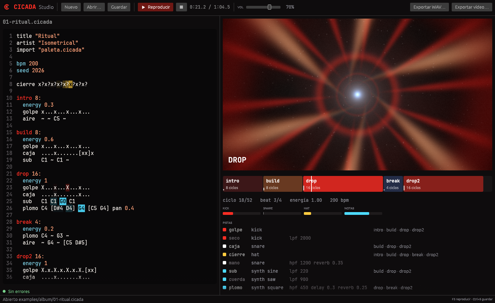
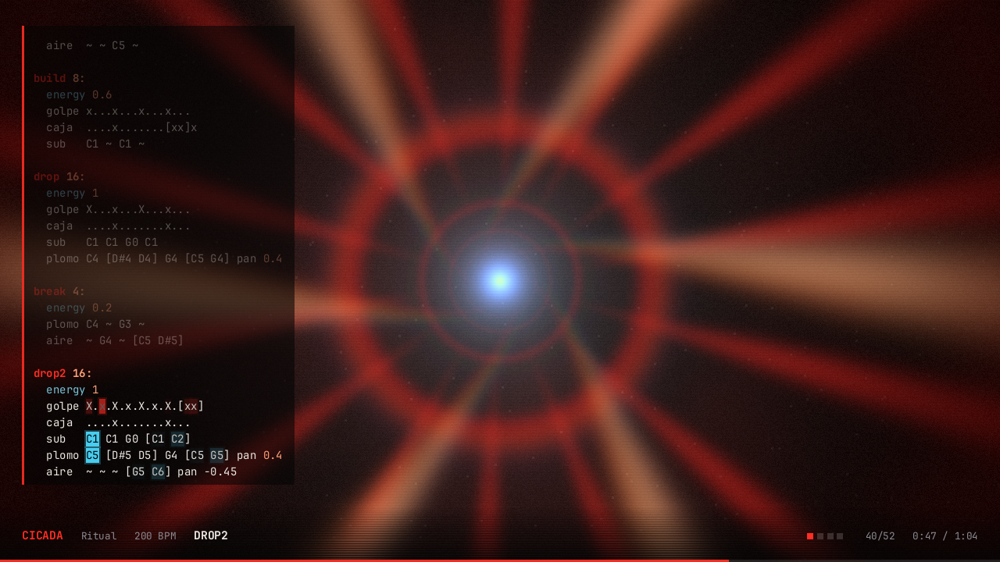
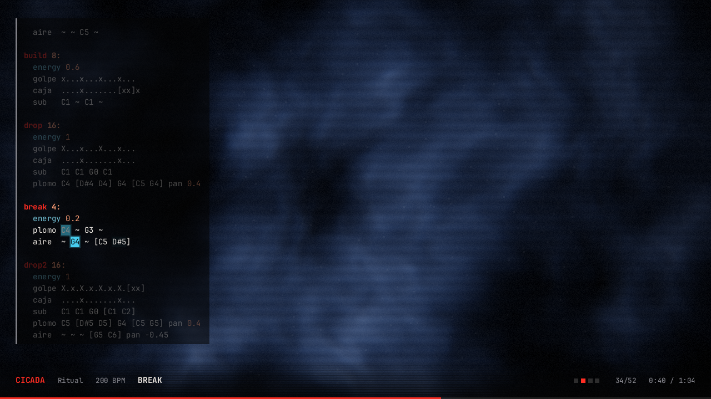

# CICADA

**Música electrónica escrita como código.**

CICADA convierte texto en patrones, los patrones en eventos y los eventos en
audio. Está pensado para música electrónica dura y rápida (Hakken, Gabber),
pero el lenguaje no está atado a ningún género.

```text
title "Hakken Ritual"
artist "Isometrical"

bpm 200
seed 2026

bass = synth saw gain 0.5 lpf 900
lead = synth square gain 0.3 delay 0.3 reverb 0.2
hat  x?x?x?x?x?x?x?x? gain 0.6 pan 0.35

intro 8:
  energy 0.3
  kick x...x...x...x... dist 0.4

drop 16:
  energy 1
  kick  X...x...X...x... dist 0.9
  snare ....x.......x... pan -0.25
  bass  C1 C1 G0 [C1 C2]
  lead  C4 [D#4 D4] G4 [C5 G4] pan 0.4
```

```sh
cicada check  track.cicada           # validar y resumir
cicada play   track.cicada           # reproducir en tiempo real
cicada render track.cicada           # exportar a WAV
cicada video  track.cicada           # exportar a MP4 con visuales sincronizadas
cicada frame  track.cicada --at 47   # un frame suelto como PNG
cicada ir     track.cicada           # ver los eventos en JSON
```



> **Estado: 0.2 en desarrollo.** El lenguaje, la síntesis, CICADA Studio y la
> exportación de vídeo con visuales ya funcionan.

---

## La idea

En CICADA **una pieza es un programa**. No hay línea de tiempo ni piano roll:
la partitura es el texto, y se puede versionar, comparar y volver a
reproducir.

Todo pasa por una representación intermedia común, la **CICADA IR**:

```text
 .cicada ──► Parser ──► AST ──► Análisis ──► CICADA IR
                                                 │
                                   ┌─────────────┴─────────────┐
                                   ▼                           ▼
                              Motor de audio             Motor visual
                                   ▼                           ▼
                                  WAV                    Frames → MP4
```

La IR describe *qué ocurre y cuándo*: cada golpe, cada nota, cada sección y su
energía. Por eso las visuales saben con exactitud cuándo suena un kick o
empieza un drop, sin tener que adivinarlo analizando la señal de audio.

## Principios

| Principio | Qué significa |
| --- | --- |
| **El código es la partitura** | Una pieza existe como texto y siempre suena igual. |
| **Determinismo** | Mismo código + misma seed ⇒ las mismas muestras. Hay tests que lo comprueban. |
| **Tiempo musical exacto** | Se escribe en ciclos y subdivisiones, que se guardan como fracciones, nunca como segundos. |
| **Separación estricta** | El lenguaje no sabe de audio, el audio no sabe de la interfaz y la IR conecta todo. |
| **Errores que ayudan** | Cada error señala la línea, la columna y qué escribir en su lugar. |
| **Sonidos que se comparten** | Una paleta importada da a todo un disco el mismo bombo y el mismo bajo. |
| **Suena alto sin romperse** | Limitador de pico real a -1 dBTP: la mezcla va alta y no distorsiona al subirla a YouTube. |

## Instalar (Windows)

Doble clic en **`install.cmd`**. Si partes del repositorio hace falta
[Rust](https://rustup.rs) 1.88 o posterior, porque el instalador compila; el
zip de la página de *releases* ya trae los programas listos.

El instalador:

- compila CICADA y lo instala en `%LOCALAPPDATA%\Programs\CICADA`, sin pedir
  permisos de administrador;
- crea el acceso directo **CICADA Studio** en el Escritorio y en el menú Inicio;
- añade la CLI `cicada` al `PATH`;
- hace que los archivos `.cicada` se abran con doble clic;
- copia los ejemplos a `Documentos\CICADA`.

Para quitarlo todo, `uninstall.ps1`. Tus piezas de `Documentos\CICADA` no se
tocan.

## CICADA Studio

- **Editor** con números de línea y resaltado. Los errores se subrayan
  mientras escribes, con su posición y una ayuda.
- **Recarga en caliente**: cada cambio se oye al instante, sin cortar la
  reproducción ni volver al principio.
- **Vista previa en vivo** con el mismo shader que el vídeo exportado.
- **Los pasos se iluminan** en el editor mientras suenan.
- **Línea de tiempo** con las secciones y su energía; un clic salta a ese momento.
- **Volumen de escucha** independiente de lo que se exporta.
- **Exportar** a WAV y a MP4. Si falta FFmpeg, ofrece instalarlo con `winget`.

Atajos: `F5` reproducir o pausar, `Ctrl+S` guardar, `Ctrl+O` abrir.

## Desde la terminal

```sh
cargo run --release -- check  examples/album/01-ritual.cicada
cargo run --release -- play   examples/album/01-ritual.cicada
cargo run --release -- render examples/album/01-ritual.cicada   # → examples/album/01-ritual.wav
cargo run --release -- video  examples/album/01-ritual.cicada   # → examples/album/01-ritual.mp4
cargo test
```

`video` necesita [FFmpeg](https://ffmpeg.org) en el `PATH` (en Windows:
`winget install Gyan.FFmpeg`) o su ruta en la variable `CICADA_FFMPEG`.

## Ejemplos

En [examples/](examples/) hay cinco piezas que se leen en orden, cada una
con su tema y con cosas que tocar al final:

| | |
| --- | --- |
| [01 · Primeros pasos](examples/01-primeros-pasos.cicada) | Golpes, silencios y tempo |
| [02 · Notas y sonidos](examples/02-notas-y-sonidos.cicada) | Declarar un synth y tocar notas |
| [03 · Secciones](examples/03-secciones.cicada) | Intro, build, drop y break, con sus escenas |
| [04 · Efectos](examples/04-efectos.cicada) | Filtros, delay, reverb y estéreo |
| [05 · Azar](examples/05-azar.cicada) | `?`, `seed` y por qué siempre suena igual |

Y en [examples/album/](examples/album/) hay un mini disco: una
[paleta](examples/album/paleta.cicada) con los sonidos y dos tracks que la
importan. Es el caso para el que existe `import`.

La sintaxis completa está en [docs/LANGUAGE.md](docs/LANGUAGE.md).

## Arquitectura

| Crate | Responsabilidad |
| --- | --- |
| `cicada-core` | Lexer, parser, análisis semántico, motor de patrones e IR. Solo depende de `serde`. |
| `cicada-audio` | Síntesis propia (kick gabber, snare, hat, osciladores PolyBLEP, samples), efectos, mezcla estéreo con limitador, render y tiempo real (CPAL) |
| `cicada-visual` | Línea de tiempo visual, shader en `wgpu`, código en pantalla y exportación con FFmpeg |
| `cicada-cli` | Comandos `check`, `render`, `play`, `video`, `frame` e `ir` |
| `cicada-studio` | La aplicación de escritorio (egui) |

Los detalles (patrones como consultas, azar determinista, muestra exacta,
visuales y limitador de destellos) están en
[docs/ARCHITECTURE.md](docs/ARCHITECTURE.md).

## Visuales

Las visuales no analizan el audio para adivinar el ritmo: leen la IR, así que
cada frame sabe exactamente qué suena en ese instante.

| Drop | Break |
| --- | --- |
|  |  |

- **Impulsos**: cada kick es un golpe de zoom y aberración cromática; cada
  snare, un glitch.
- **Energía**: la `energy` de la sección controla la velocidad y la intensidad.
- **Estructura**: cada tipo de sección tiene su escena (túnel en la intro,
  rejilla que acelera en el build, rayos en el drop, niebla en el break) con
  fundidos entre ellas.
- **El código en pantalla**: los pasos que suenan se iluminan con el color de
  su rol (kick en rojo, snare en blanco, hat en amarillo, notas en cian).
- **Seguro para la fotosensibilidad**: el kick se expresa en movimiento, no en
  brillo, y los destellos están limitados a 3 por segundo.

## Roadmap

| Versión | Objetivo | Contenido |
| --- | --- | --- |
| **0.1 — Sonar** | De texto a audio | ✅ lenguaje, secciones, seeds, IR, síntesis, WAV, `play` · pendiente: pulir el sonido del kick |
| **0.2 — Ver** | Un vídeo listo para YouTube | ✅ motor visual en `wgpu`, cuatro escenas, código en pantalla, cabecera con `title`/`artist`, limitador de destellos, `cicada video` → MP4 · siguiente: texturas a partir de la FFT |
| **0.3 — Componer** | Piezas más ricas | ✅ estéreo, filtros, delay, reverb y limitador · siguiente: transformaciones (`euclid`, `every`, `rev`) y automatización |
| **0.4 — En vivo** | Live coding | ✅ CICADA Studio con recarga en caliente · siguiente: MIDI y controladores, grabar la sesión en vivo |
| **0.5 — Web** | Probar sin instalar | Playground en el navegador con el core compilado a WASM |

## Qué no es

No es un DAW, ni un clon de Strudel o TidalCycles, ni un editor MIDI o de vídeo.
Es una herramienta pequeña para componer escribiendo.

## Motivación

CICADA nace para producir un LP de Hakken / Gabber donde cada track es una
sesión reproducible, y un mismo `track.cicada` produce `track.wav` y
`track.mp4` perfectamente sincronizados.

## Licencia

[MIT](LICENSE).

## Créditos

El código en pantalla usa [JetBrains Mono](https://www.jetbrains.com/lp/mono/),
bajo la licencia SIL Open Font License
([crates/cicada-visual/assets/JetBrainsMono-OFL.txt](crates/cicada-visual/assets/JetBrainsMono-OFL.txt)).
